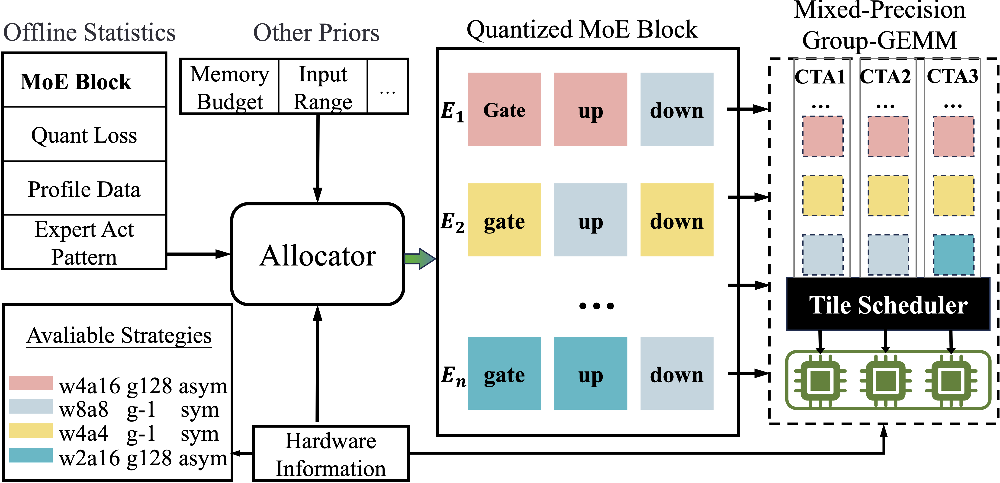
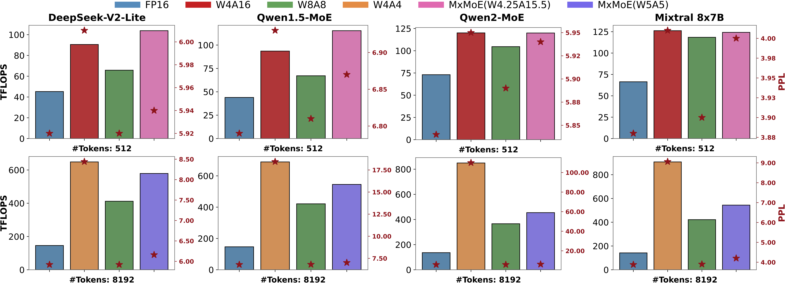

# MxMoE: Mixed-precision Quantization for MoE with Accuracy and Performance Co-Design
<div align="center">

[](https://arxiv.org/abs/2505.05799)&nbsp;


[Haojie Duanmu](https://cat538.github.io/)<sup>1,2</sup> | [Xiuhong Li](https://scholar.google.com/citations?user=90eREm0AAAAJ&hl=en)<sup>3</sup> | [Zhihang Yuan](https://zhihang.cc/)<sup>3</sup> | [Size Zheng](https://sizezheng.github.io/)<sup>4</sup> | [Jiangfei Duan](https://jf-d.github.io/)<sup>5</sup><br> Xingcheng Zhang<sup>2</sup> | Dahua Lin<sup>2,5</sup>

<sup>1</sup>SJTU, <sup>2</sup>Shanghai AI Laboratory, <sup>3</sup>PKU, <sup>4</sup>Bytedance Seed, <sup>5</sup>CUHK.
</div>


## 🙈 TL;DR
> Can we design a quantization scheme specifically tailored to MoE models that effectively balancing model accuracy and computational efficiency?

**Insight**:

- Linear-block level: Linear blocks exhibit varying quantization sensitivity
- Expert level: Imbalanced activation frequencies $\Rightarrow$ heterogeneous computational characteristics (e.g. some experts are compute-bound while some are memory-bound).

**Approach**:

We explore the automated design of mixed-precision quantization scheme for MoE models:

1. Assign bitwidth at linear-block level.
2. Optimize bitwidth allocation (which is formulated as an ILP) by taking both model accuracy (quantization loss estimation) and computational efficiency (performance model) into consideration.
3. Generate mixed-precision GroupGEMM operator through template-based kernel generation.




## 🚀 Results



## 🛠️ Usage

1. Configure the shared environment:

    Follow the [MxMoE environment guide](doc/environment.md) for the unified
    `mxmoe` Conda environment, CUDA toolchain, and source-built extensions.
    **Accuracy and performance use the same stack**, including the local
    editable `3rdparty/vllm`; do not install a separate legacy accuracy stack.
    After setup, activate it before running the examples below:

    ```bash
    conda activate mxmoe
    ```

2. View the activation statistic of MoE models:

    ```bash
    # e.g. sample data from humaneval-x to observe qwen2_moe (in fact qwen1.5moe)
    CUDA_VISIBLE_DEVICES=0 python -m mxmoe.quant.moe_tracer --model qwen2_moe --trace_gate --dataset humaneval-x
    ```

3. Calibration

    1. Get the quant loss of each linear-blocks of `<MOE_MODEL>` (e.g. `qwen2_moe`) under certain `<QUANTIZATION_CONFIG>` (e.g. `w4a4_g-1_sym`):

        ```bash
        CUDA_VISIBLE_DEVICES=0 python -m mxmoe.quant.quant calib --model qwen2_moe --method rtn --metric layer_out_norm --qcfg w4a4_g-1_sym
        ```
    2. Solve the ILP based on the quant loss and kernel profile. Quantization scheme will be saved in `qconfigs`

        ```bash
        # e.g. re-produce mxmoe w5a5
        python -m mxmoe.quant.bits_solver --model qwen2_moe --qtype gptq-had --wbits 5.0 --solve_mode layer --batch 8192 --filter_list w4a4_g-1_sym w8a8_g-1_sym
        ```

4. Accuracy Eval. You can re-produce the exp in paper by setting corresponding tasks and quantization configs.

    ```bash
    # e.g. evaluate the performance of qwen1.5_moe under RTN w4a4_g-1_sym quantization config
    CUDA_VISIBLE_DEVICES=2 python -m mxmoe.quant.quant eval --model qwen2_moe --method rtn-had --qstr w4a4_g-1_sym --tasks ppl
    ```

5. Performance (Computational Efficiency) Eval. After we get the mixed-precision scheme (Step 3), we can automatially generate corresponding GroupGEMM kernel.

    please refer to [run_mxmoe_gg.py](./run_mxmoe_gg.py).

    ```bash
    # e.g. test groupgemm in the layer-11 of qwen2_moe model (FP16):
    python run_mxmoe_gg.py --model qwen2_moe --bs 8192 --layer 11

    # e.g. test groupgemm in the layer-11 of qwen2_moe model under mixed-precision
    python run_mxmoe_gg.py --model qwen2_moe --bs 8192 --layer 11 --qconfig <QCONFIG> --tile_config <TCONFIG>
    ```

### Uniform GPTQ checkpoints for vLLM

This is separate from the mixed-precision GroupGEMM benchmark. The
`compressed_tensors` export preserves GPTQ codes, FP32 scales, and raw zero
points for vLLM/Humming; `hf_float` does not select a low-bit inference kernel.
GPTQ runs in `mxmoe.quant.export_gptq_hf`, not vLLM. Defaults: WikiText2 **train**,
128×4096 tokens, seed 42, damping 0.01, asymmetric weights, static groups.

Use the shared CUDA 12.8 `mxmoe` environment. Source model paths belong in
`.env`; exports and measurement JSON belong in gitignored output directories.

```bash
conda run --no-capture-output -n mxmoe python project_config.py --check ds2
CUDA_VISIBLE_DEVICES=0 conda run --no-capture-output -n mxmoe \
  python -m mxmoe.quant.export_gptq_hf --model ds2 --wbits 2 --groupsize 128 \
  --device-map cpu --export-format compressed_tensors --pad-dense-ffn \
  --save outputs/ds2-gptq-w2-g128-asym-ct-padffn
CUDA_VISIBLE_DEVICES=0 conda run --no-capture-output -n mxmoe \
  python run_vllm_gptq.py outputs/ds2-gptq-w2-g128-asym-ct-padffn \
  --prompt-len 512 --batch-size 1 --output-tokens 128 --warmup 3 --repeats 5 \
  --dtype half --trust-remote-code --output out/bench/ds2-w2a16-vllm.json
```

For ds2, TP=1 padding changes only the exported dense FFN width, 10944→11008.
Gate/up remain separate; added weights encode zero as `q == zero_point`.
Source weights and expert width remain unchanged. This export does not support
Hadamard, activation order, or partial-layer checkpoints.

Qwen1.5-MoE-A2.7B is `qwen2_moe`: 24 MoE layers, each with 60 routed experts
(width 1408) and one shared MLP (width 5632). Both widths are group-128 aligned;
no `--pad-dense-ffn` is needed. Export keeps the model on CPU and quantizes
layers on the visible GPU. The runner derives shape checks from `config.json`;
explicit `--expect-*-size` values override them, and 0 disables a check.

```bash
conda run --no-capture-output -n mxmoe python project_config.py --check qwen2_moe
CUDA_VISIBLE_DEVICES=0 conda run --no-capture-output -n mxmoe \
  python -m mxmoe.quant.export_gptq_hf --model qwen2_moe --wbits 2 --groupsize 128 \
  --device-map cpu --export-format compressed_tensors \
  --save outputs/qwen2_moe-gptq-w2-g128-asym-ct
CUDA_VISIBLE_DEVICES=0 conda run --no-capture-output -n mxmoe \
  python run_vllm_gptq.py outputs/qwen2_moe-gptq-w2-g128-asym-ct \
  --dtype half --output out/bench/qwen2_moe-w2a16-vllm.json
```

For W4/W8 exports, set both export `--wbits` and runner `--weight-bits`.
The A16 runner observes real Humming calls in a separate eager engine, then
times an uninstrumented engine. Prefill/decode/TPOT/TTFT are request-phase
intervals, not isolated CUDA kernel timings. Prefix caching is disabled;
multi-request batches use a scheduler barrier. The W4/W8 Humming group-size
fix is installed by `mxmoe/vllm_gptq_audit.py` before worker model loading,
without modifying vLLM submodule sources or wrapping timed forward calls.

For INT4/INT8 activations, reuse the checkpoint with `--activation-bits 4`
or `8`, `--batch-size 1 --tensor-parallel-size 1`. This uses a loaded-precision
check rather than the A16 observation pass; activation fallback is forbidden.
Only quantized MLPs use dynamic per-token activations; attention stays floating.
Humming rejects same-width integer weights with zero points, so the current
asymmetric W4A4/W8A8 checkpoints cannot use those activation modes.

#### Held-out quality

`--quality-data` enables natural completions and teacher-forced PPL **after**
timed repeats, on the same engine. The runner owns quality evaluation; no
separate evaluation script is needed. Build input with the model's tokenizer:

```bash
conda run --no-capture-output -n mxmoe python - <<'PY'
import json
from pathlib import Path
from project_config import check_model_paths
from mxmoe.quant.data_utils import get_wikitext2
from mxmoe.quant.moe_utils import load_tokenizer

model_id, length = "ds2", 4096  # use qwen2_moe for Qwen
assert check_model_paths([model_id])
_, encoded = get_wikitext2(128, 42, length, load_tokenizer(model_id), model_id, test_only=True)
tokens = encoded[0].tolist()
data = {
    "dataset": {"name": "Salesforce/wikitext", "split": "test",
                "sequence_length": length, "dropped_tail_tokens": len(tokens) % length},
    "prompts": ["The capital of France is", "人工智能是一种"],
    "token_windows": [tokens[i:i + length] for i in range(0, len(tokens) - length + 1, length)],
}
path = Path(f"out/bench/{model_id}-quality-wikitext2.json")
path.parent.mkdir(parents=True, exist_ok=True)
path.write_text(json.dumps(data, ensure_ascii=False), encoding="utf-8")
PY
```

Append to the runner command:

```bash
--quality-data out/bench/ds2-quality-wikitext2.json \
--quality-output-tokens 64 --max-model-len 4097
```

PPL is `exp(total NLL / predicted tokens)`, excluding each window's first token,
not the mean of window PPLs. Missing/non-finite scores and rewritten/truncated
inputs fail the run. The context must fit each window plus one token and each
natural prompt plus its completion. JSON records counts, per-window NLL,
aggregate PPL, and generated text; execution success is not a quality threshold.

All regression checks live in `tests/test_vllm_gptq.py`: packing/quality logic
runs on CPU; Humming initialization requires CUDA SM75+ and Humming, or is skipped.

```bash
conda run --no-capture-output -n mxmoe python -m pytest -q tests/test_vllm_gptq.py
```


## 👀 Limitations

⚠️ MxMoE is mainly test on RTX-4090. The current implementation cannot fully utilize the performance of hopper and later GPU architectures.

⚠️ The profile step is a little bit time consuming. We expect to upload our previously calculated quant loss statistics and kernel profile data soon, allowing you to skip this step.


## 😺 Citation
If you find MxMoE useful or relevant to your project and research, please kindly cite our paper:

```latex
@article{duanmu2025mxmoe,
  title={MxMoE: Mixed-precision Quantization for MoE with Accuracy and Performance Co-Design},
  author={Duanmu, Haojie and Li, Xiuhong and Yuan, Zhihang and Zheng, Size and Duan, Jiangfei and Zhang, Xingcheng and Lin, Dahua},
  journal={arXiv preprint arXiv:2505.05799},
  year={2025}
}
```